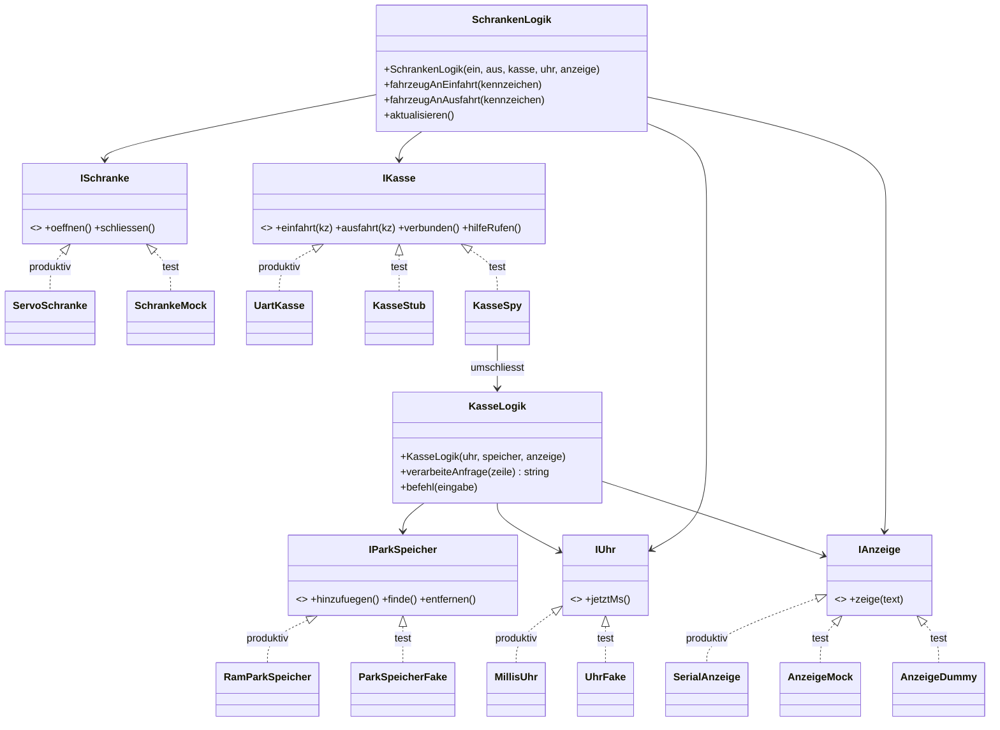

# M450 – Automatisiertes Parksystem: Test Doubles

**Gruppenmitglied:** Rahul Vaikunthavasan (Einzelarbeit, INA24cL)
**Modul:** M450 – Applikationen testen
**Auftrag:** A02-01 Automatisierte Tests mit Test Doubles (Branch `testdoubles`)
**Grundlage:** Umsetzung v1.1 (Branch `main`), Testkonzept v1.1 und Testprotokoll v2.0

Ziel: Die Logik des Parksystems wird **automatisiert und ohne Hardware** getestet. Alle Abhängigkeiten zu Hardware und Umgebung (Servo, Zeit, Verbindung zwischen den Picos, Bildschirm, Speicherung) sind hinter Schnittstellen versteckt und werden der Logik über den Konstruktor übergeben (**Dependency Injection**). Im Test werden sie durch **Test Doubles** ersetzt. Auf den Picos läuft die Applikation unverändert weiter.

---

## Schnellstart

```bash
# Automatisierte Tests auf dem PC (kein Pico nötig)
cd Kasse             && pio test -e native
cd Parkhaus_Schranke && pio test -e native

# Firmware wie bisher auf die Picos laden
cd Kasse             && pio run -e pico -t upload
cd Parkhaus_Schranke && pio run -e pico -t upload
```

Voraussetzung für `-e native` unter Windows: ein C++-Compiler (z. B. `scoop install mingw`).

Ergebnis: **54 automatisierte Tests, alle bestanden** (Kasse 30, Schranke 24). Ein Testlauf dauert etwa 3 Sekunden statt rund 2 Stunden manueller Durchführung.

---

## Aufbau

```
M450_Code/
├── lib/
│   ├── Parksystem/            ← produktive Logik, OHNE Arduino/Hardware
│   │   └── src/
│   │       ├── Schnittstellen.h   IUhr, IAnzeige, ISchranke, IKasse, IParkSpeicher
│   │       ├── KasseLogik.*       Logik Pico 1 (Einfahrt, Gebühr, Zahlung, Ausfahrt, Protokoll)
│   │       ├── SchrankenLogik.*   Logik Pico 2 (Ein-/Ausfahrt, automatisches Schliessen)
│   │       ├── RamParkSpeicher.h  produktive Speicherung (10 Plätze im RAM)
│   │       ├── Kennzeichen.*, Tarif.h, KassenProtokoll.h, Text.h
│   └── TestDoubles/           ← nur für Tests, wird nie auf den Pico geladen
│       └── src/ UhrFake.h, AnzeigeDoubles.h, SchrankeMock.h,
│                KasseStub.h, KasseSpy.h, ParkSpeicherFake.h
├── Kasse/                     Pico 1
│   ├── src/main.cpp           nur Adapter: MillisUhr, SerialAnzeige, UART
│   └── test/test_kasse, test/test_bausteine
└── Parkhaus_Schranke/         Pico 2
    ├── src/main.cpp           nur Adapter: MillisUhr, SerialAnzeige, ServoSchranke, UartKasse
    └── test/test_schranke, test/test_integration
```



Beispiel Dependency Injection (Pico 2):

```cpp
// Produktiv (Parkhaus_Schranke/src/main.cpp)
SchrankenLogik logik(einfahrtServo, ausfahrtServo, uartKasse, millisUhr, serialAnzeige);

// Im Test (Parkhaus_Schranke/test/test_schranke)
SchrankenLogik logik(schrankeMockEin, schrankeMockAus, KasseStub::erlaubtAlles(), uhrFake, anzeigeMock);
```

---

## Identifizierte Abhängigkeiten und gewählte Test Doubles

| Abhängigkeit | Wo | Warum nicht im automatisierten Test? | Was braucht die Logik wirklich? | Test Double | Begründung |
|---|---|---|---|---|---|
| **Schranke** (Servo SG90, `Servo.write()` an GP8/GP9) | Pico 2 | Braucht Pico und Servo; ob sie offen ist, muss man **hinschauen**. Nicht automatisch prüfbar. | Nur zwei Befehle: `oeffnen()`, `schliessen()` | **Mock** `SchrankeMock` | Der Test muss prüfen, **ob und wie oft** die Logik den Servo angesteuert hätte (z. B. bei abgelehnter Einfahrt: 0 × öffnen; nach 5 s: 1 × schliessen). Ein Mock merkt sich die Aufrufe. |
| **Zeit** (`millis()`) | Pico 1 + 2 | **Langsam** (Testfall «10 min parken» dauert 10 min) und **nicht deterministisch** (jede Ausführung ergibt eine andere Parkdauer → Gebühr schwankt an den Minutengrenzen). | Aktuelle Zeit in ms: `jetztMs()` | **Fake** `UhrFake` | Eine vereinfachte, aber funktionierende Uhr, die nur weiterläuft, wenn der Test `vorspulen()` aufruft. So sind Grenzwerte wie 60 000 ms vs. 60 001 ms exakt testbar. Ein Stub (immer gleiche Zeit) würde nicht reichen, weil die Zeit im Test fortschreiten muss. |
| **Kommunikation Pico 2 → Pico 1** (UART, `Serial1`; im Auftrag als WLAN/HTTP beschrieben) | Pico 2 | Braucht **beide** Picos und Kabel. Fehlerfälle wie «keine Verbindung» oder «Kasse lehnt ab» sind nur **aufwändig** herzustellen (Kabel abziehen, vorher bezahlen usw.). | Für ein Kennzeichen: OK / abgelehnt (mit Grund) / keine Verbindung | **Stub** `KasseStub` | Für die isolierten Schranken-Tests genügt eine fest eingestellte Antwort ohne Logik (`erlaubtAlles()`, `lehntAb("…")`, `ohneVerbindung()`). Der Parameter wird ignoriert. Damit ist z. B. TC15 in 1 ms testbar. |
| | | | | **Spy** `KasseSpy` | Für die Integrationstests umschliesst der Spy die **echte** `KasseLogik` und das echte Textprotokoll und zeichnet jede Anfrage auf. Nur das Kabel fällt weg. So wird das Zusammenspiel beider Picos getestet und zusätzlich geprüft, welche Anfragen gesendet wurden (z. B. bei leerem Kennzeichen **keine**). |
| **Bildschirm / Meldungen** (`Serial.println()`) | Pico 1 + 2 | Ausgabe geht in den seriellen Monitor; ein Mensch müsste sie lesen. | Eine Textzeile ausgeben: `zeige(text)` | **Mock** `AnzeigeMock` | Viele Akzeptanzkriterien verlangen eine **verständliche Meldung** (US03, US08, US10). Der Mock speichert alle Zeilen, der Test prüft den Text. |
| | | | | **Dummy** `AnzeigeDummy` | In Tests, in denen die Meldungen keine Rolle spielen (z. B. nur die Gebühr), wird die Anzeige nur übergeben, weil der Konstruktor sie verlangt. |
| **Speicherung der Fahrzeuge** (10 Plätze im RAM, später evtl. Flash, siehe Einschränkung E-2) | Pico 1 | Ein bestimmter Zustand (z. B. «Fahrzeug steht seit 2 h im Parkhaus») ist nur **aufwändig** über den ganzen Ablauf herzustellen. Eine spätere Flash-Speicherung wäre langsam und hätte Seiteneffekte. | Fahrzeug hinzufügen, finden, entfernen, Anzahl/Kapazität | **Fake** `ParkSpeicherFake` | Vereinfachte Implementierung mit `std::map`, frei wählbarer Kapazität und `vorbereiten()`, um einen Zustand direkt herzustellen. Ein **Vertragstest** prüft, dass Fake und produktiver `RamParkSpeicher` sich gleich verhalten. |
| **Kamera / Kennzeichen-Eingabe** (Eingabe im seriellen Monitor statt Weboberfläche) | Pico 2 | Braucht einen Menschen, der tippt. | — (Eingabe, keine Abhängigkeit) | **kein Double** | Die Kamera ruft die Logik auf, nicht umgekehrt. Der Test übernimmt die Rolle der Kamera und ruft `fahrzeugAnEinfahrt("LU12345")` direkt auf. |

Zusammengefasst: Es werden alle fünf Arten aus T03-02 verwendet: **Dummy, Fake, Stub, Mock und Spy**.

---

## Übersicht der automatisierten Testfälle mit Bezug zum Testkonzept

Die Testnamen beginnen mit der Testfall-ID aus dem Testkonzept (TC01–TC20) bzw. der Fehler-ID aus dem Testprotokoll (F-…).

### Kasse – `Kasse/test/test_kasse` (23 Tests, Doubles: UhrFake, ParkSpeicherFake, AnzeigeMock, AnzeigeDummy)

| Test | Testkonzept | Prüft |
|---|---|---|
| `test_TC01_einfahrt_speichert_kennzeichen_mit_datum_und_uhrzeit` | TC01 / US01 | Kennzeichen gespeichert, Anzeige «Einfahrt: 14.11.2026 13:36:12» |
| `test_TC02_einfahrtszeit_entspricht_exakt_der_uhrzeit` | TC02 / US01 | Einfahrtszeit = Uhrzeit (Abweichung 0 ms) |
| `test_TC03_leeres_kennzeichen_wird_abgelehnt_ohne_parkvorgang` | TC03 / US10 | Kein Parkvorgang bei leerem Kennzeichen |
| `test_TC05_ungueltiges_kennzeichen_wird_abgelehnt_und_protokolliert` | TC05 / US03 | XX00000 abgelehnt, Protokolleintrag |
| `test_TC06_parkvorgang_erscheint_in_der_liste_mit_status` | TC06 / US04 | Liste: Platz, Kennzeichen, IM PARKHAUS, UNBEZAHLT |
| `test_TC07_parkvorgang_bleibt_nach_zwei_minuten_bestehen` | TC07 / US04 | Parkvorgang nach 2 min (vorgespult) noch vorhanden |
| `test_TC08_gebuehr_nach_302_sekunden_ist_chf_1_60` | TC08 / US05 | Betrag und Anzeige |
| `test_TC09_kurzer_und_langer_aufenthalt` | TC09 / US05 | 30 s → CHF 1.10, 10 min → CHF 2.00 |
| `test_TC09_zwei_stunden_parkdauer_mit_vorbereitetem_fake` | TC09 / US05 | 2 h → CHF 13.00 (Zustand mit Fake vorbereitet) |
| `test_TC10_erfolgreiche_zahlung_markiert_als_bezahlt` | TC10 / US06 | Status BEZAHLT, Meldung mit Betrag |
| `test_TC10_F008_bezahlter_betrag_bleibt_fix` | TC10 / F-008 | Gebühr steigt nach Zahlung nicht weiter |
| `test_TC11_fehlgeschlagene_zahlung_bleibt_unbezahlt` | TC11 / US06 | Status bleibt UNBEZAHLT, Ausfahrt gesperrt |
| `test_TC13_unbezahlte_ausfahrt_wird_mit_betrag_abgelehnt` | TC13 / US08 | Meldung mit offenem Betrag CHF 1.10 |
| `test_TC14_ausfahrt_schliesst_parkvorgang_mit_ausfahrtszeit_ab` | TC14 / US09 | Ausfahrtszeit, Historie, Betrag |
| `test_TC17_ausfahrt_ohne_einfahrt_wird_abgelehnt` | TC17 | «Kein aktiver Parkvorgang» |
| `test_TC18_doppelte_einfahrt_wird_abgelehnt` | TC18 | Zweite Einfahrt abgelehnt |
| `test_TC19_elftes_fahrzeug_wird_bei_vollem_parkhaus_abgelehnt` | TC19 | «Parkhaus voll» |
| `test_TC19_nach_einer_ausfahrt_ist_wieder_ein_platz_frei` | TC19 | Platz wird wieder frei |
| `test_TC20_hilferuf_wird_angezeigt_und_protokolliert` | TC20 / US10 | Anzeige und Protokoll |
| `test_protokoll_einfahrt_ok_und_abgelehnt` | TC04, TC05 | UART-Antworten REG/PING |
| `test_uhr_stellen_lehnt_ungueltige_eingaben_ab` | NF 6.7 | Robuste Eingabe |
| `test_unbekannter_befehl_zeigt_hilfe_hinweis` | NF 6.3 | Hinweis auf Hilfe |
| `test_dummy_anzeige_wenn_meldungen_keine_rolle_spielen` | TC16 | Beispiel für Dummy |

### Bausteine – `Kasse/test/test_bausteine` (7 Tests, ohne Doubles + Vertragstest)

| Test | Testkonzept | Prüft |
|---|---|---|
| `test_kennzeichen_wird_normalisiert` | TC18 | «lu 12345» = «LU12345» |
| `test_TC05_gueltige_und_ungueltige_kennzeichen` | TC05 / US03 | Grenzwerte 1/6/7 Ziffern, Kanton, führende 0 |
| `test_TC16_tarif_grenzwerte` | TC16 / US05 | 0, 1, 59 000, 60 000, 60 001, 61 000, 119 000, 121 000 ms |
| `test_TC08_TC09_tarif_standardwerte` | TC08, TC09 | 31 s, 302 s, 604 s |
| `test_protokoll_antworten_auswerten` | TC15 | OK / ERR / Timeout |
| `test_speicher_vertrag_ram_speicher_produktiv` | – | Vertrag produktiver Speicher |
| `test_speicher_vertrag_park_speicher_fake` | – | gleicher Vertrag für den Fake |

### Schranke – `Parkhaus_Schranke/test/test_schranke` (13 Tests, Doubles: SchrankeMock, KasseStub, UhrFake, AnzeigeMock, AnzeigeDummy)

| Test | Testkonzept | Prüft |
|---|---|---|
| `test_start_schliesst_beide_schranken` | Ausgangszustand 3.3 | Beide Schranken beim Start zu |
| `test_TC04_gueltiges_kennzeichen_oeffnet_nur_die_einfahrt` | TC04 / US02 | 1 × öffnen Einfahrt, 0 × Ausfahrt |
| `test_TC04_einfahrt_schliesst_genau_nach_5_sekunden` | TC04 / US02 | Bei 4 999 ms offen, bei 5 000 ms zu |
| `test_TC03_ohne_kennzeichen_bleibt_schranke_zu_mit_hinweis_auf_hilfe` | TC03 / US10 | Keine Öffnung, Hinweis auf R |
| `test_TC05_abgelehntes_kennzeichen_oeffnet_nicht` | TC05 / US03 | Meldung, Schranke zu |
| `test_TC12_bezahlte_ausfahrt_oeffnet_nur_die_ausfahrt` | TC12 / US07 | Öffnen und Schliessen Ausfahrt |
| `test_TC13_unbezahlte_ausfahrt_bleibt_zu` | TC13 / US08 | Meldung mit Betrag, Schranke zu |
| `test_TC15_ohne_verbindung_zur_kasse_bleibt_schranke_zu` | TC15 / US10 | Sicherer Zustand, Meldung, Status |
| `test_TC15_nach_wiederherstellung_funktioniert_die_ausfahrt` | TC15 | Nach Wiederherstellung öffnet sie |
| `test_TC20_hilferuf_mit_und_ohne_verbindung` | TC20 / US10 | Beide Meldungen |
| `test_F006_befehl_O_oeffnet_keine_schranke` | F-006 / NF 6.2 | Sicherheitslücke bleibt geschlossen (Regression) |
| `test_befehl_S_schliesst_beide_schranken` | – | Service-Befehl |
| `test_geschlossene_schranke_wird_nicht_ohne_grund_bewegt` | NF 6.1 | Keine unerwarteten Servo-Bewegungen |

### Integration Pico 2 + Pico 1 – `Parkhaus_Schranke/test/test_integration` (11 Tests, Doubles: KasseSpy, SchrankeMock, UhrFake, AnzeigeMock, AnzeigeDummy; echte KasseLogik und echter RamParkSpeicher)

| Test | Testkonzept | Prüft |
|---|---|---|
| `test_E2E_kernprozess_einfahrt_zahlung_ausfahrt` | End-to-End 4.4, TC12, TC14 | Ganzer Kernprozess, gesendete Anfragen REG/EXIT |
| `test_TC13_integration_unbezahlt_bleibt_ausfahrt_zu` | TC13 | über beide Picos |
| `test_TC11_integration_fehlgeschlagene_zahlung_gibt_nicht_frei` | TC11 | über beide Picos |
| `test_TC05_integration_ungueltiges_kennzeichen` | TC05 | Antwort ERR REG und Protokoll |
| `test_TC03_leeres_kennzeichen_sendet_keine_anfrage` | TC03 | Spy: keine Anfrage an Pico 1 |
| `test_TC17_integration_ausfahrt_ohne_einfahrt` | TC17 | über beide Picos |
| `test_TC18_integration_doppelte_einfahrt` | TC18 | über beide Picos |
| `test_TC19_integration_volles_parkhaus_mit_produktivem_speicher` | TC19 | mit produktivem Speicher |
| `test_TC20_integration_hilferuf_erreicht_die_kasse` | TC20 | HELP kommt an der Kasse an |
| `test_status_meldet_verbindung_ok` | TC15 | PING/PONG |
| `test_zuverlaessigkeit_kernprozess_fuenfmal_hintereinander` | NF 6.1 | 5 × Kernprozess ohne unerwartete Zustände |

### Abdeckung Testkonzept

| Testfall | Automatisiert? | Bemerkung |
|---|---|---|
| TC01, TC03, TC05–TC11, TC13, TC14, TC16–TC20 (16 Testfälle) | ✅ vollständig | Logik und Meldungen |
| TC02 | ✅ Logik / ❌ Genauigkeit der echten Uhr | siehe Fazit |
| TC04, TC12 | ✅ Ansteuerung / ❌ mechanische Bewegung | siehe Fazit |
| TC15 | ✅ Verhalten bei Verbindungsfehler / ❌ echter Kabelunterbruch | siehe Fazit |
| NF 6.1 Zuverlässigkeit, 6.2 Sicherheit, 6.7 Fehlerbehandlung, 6.8 Nachvollziehbarkeit | ✅ Logik | |
| NF 6.3 Benutzerfreundlichkeit, 6.4 Performance, 6.5 Datenschutz, 6.6 Verfügbarkeit | ❌ | siehe Fazit |

---

## Fazit: Was lässt sich nicht automatisieren und warum?

Mit den Test Doubles ist die **gesamte Logik** beider Picos automatisiert testbar: 16 der 20 Testfälle vollständig, die übrigen 4 (TC02, TC04, TC12, TC15) im logischen Teil. Die Tests laufen in Sekunden, sind deterministisch (gleiche Eingabe → gleiches Ergebnis) und können nach jeder Änderung als Regressionstest laufen. Lange Wartezeiten (TC07, TC09) und schwer herstellbare Fehler (TC15) sind jetzt sofort testbar.

Nicht automatisieren lässt sich alles, was **genau in den Adaptern oder in der echten Welt** liegt, die wir durch Doubles ersetzt haben:

| Testfall | Was bleibt manuell? | Warum |
|---|---|---|
| **TC04, TC12** (Schranke öffnet/schliesst) | Ob sich der Servo wirklich auf 90° bzw. 0° bewegt | Der `SchrankeMock` prüft nur, dass `oeffnen()` aufgerufen wurde. Ob `ServoSchranke` richtig verkabelt ist und der Servo mechanisch funktioniert, braucht Hardware und Hinschauen. |
| **TC15** (Kommunikationsunterbruch) | Echtes Abziehen des UART-Kabels, Timeout von 2 s, Fehler F-009 (Rückkanal unterbrochen) | Der `KasseStub` simuliert nur das Ergebnis «keine Verbindung». Das Timing auf der Leitung und der Fall, dass Pico 1 die Anfrage erhält, Pico 2 die Antwort aber nicht, geschieht in `UartKasse` bzw. auf dem Kabel. |
| **TC02** (Genauigkeit max. 2 s) | Abweichung zur echten Uhrzeit | Die `UhrFake` ist per Definition exakt. Wie genau die Uhr nach dem manuellen Stellen mit `T` läuft, zeigt nur der Vergleich mit einer echten Uhr. |
| **NF 6.4 Performance** (max. 3 s) | Reaktionszeit Eingabe → Schranke | Laufzeit auf dem Pico, UART und Servo-Bewegung existieren im PC-Test nicht. |
| **NF 6.3 Benutzerfreundlichkeit** | Sind die Meldungen verständlich? | Der Test prüft, dass ein Text erscheint, nicht ob ein Mensch ihn versteht. |
| **NF 6.6 Verfügbarkeit** | Neustart der Picos, Datenverlust (E-2) | Betrifft Hardware, Stromversorgung und Flash. |
| **NF 6.5 Datenschutz** | Welche Daten gespeichert/angezeigt werden | Inhaltliche Beurteilung (Review), kein Funktionstest. |
| Upload, Verkabelung, Pinbelegung | ob die Firmware startet und die Pins stimmen | Nur auf der echten Hardware prüfbar. |

Diese Punkte bleiben deshalb im manuellen Testprotokoll (Smoke-Test nach jedem Upload). Die automatisierten Tests ersetzen die manuellen Tests also nicht ganz, verkürzen sie aber auf wenige hardwarenahe Prüfungen.

---

## Bedienung und Verkabelung (unverändert seit v1.1)

| Verbindung | Pico 1 (Kasse) | Pico 2 (Schranke) |
|---|---|---|
| UART TX → RX | GP0 (Pin 1) | GP1 (Pin 2) |
| UART RX ← TX | GP1 (Pin 2) | GP0 (Pin 1) |
| Masse | GND | GND |
| Servo Einfahrt / Ausfahrt (Signal) | – | GP8 / GP9 |
| Servo VCC / GND | – | VBUS (5 V) / GND |

**Pico 1 – Kasse:** `T 14.11.2026 13:30:00` Uhr stellen · `G <KZ>` Gebühr · `B <KZ>` Zahlung · `X <KZ>` Zahlung abbrechen · `L` Liste · `P` Historie/Protokoll · `H` Hilfe
**Pico 2 – Schranke:** `E <KZ>` Einfahrt · `A <KZ>` Ausfahrt · `S` schliessen · `Z` Status · `R` Hilfe rufen · `H` Hilfe

Tarif: CHF 1.00 + CHF 0.10 pro angefangene Minute. Gültige Kennzeichen: Kantonskürzel + 1–6 Ziffern.

## Versionen

| Version | Datum | Änderungen |
|---|---|---|
| 1.0 | 04.11.2026 | Erste Umsetzung (Code in `backup_v1.0`) |
| 1.1 | 14.11.2026 | Fehlerbehebung nach Testdurchführung (F-001 bis F-008) |
| 1.2 | 19.11.2026 | Branch `testdoubles`: Logik in `lib/Parksystem` ausgelagert, Schnittstellen und Dependency Injection, Test Doubles, 54 automatisierte Tests. Verhalten auf den Picos unverändert. |
